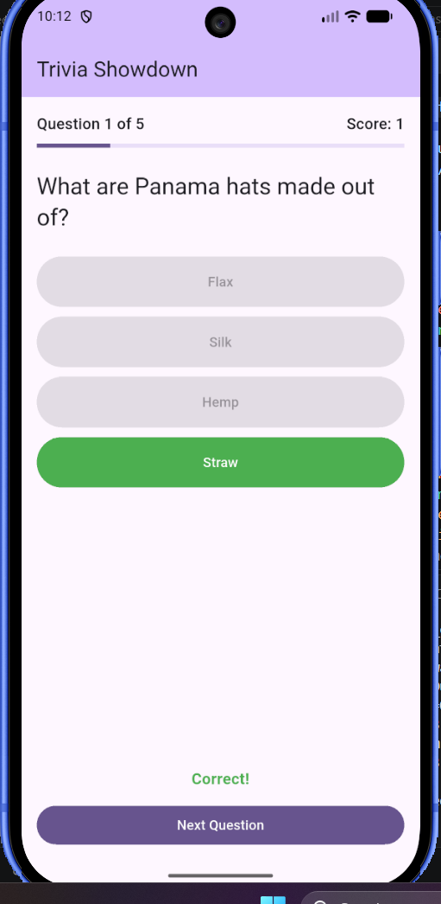
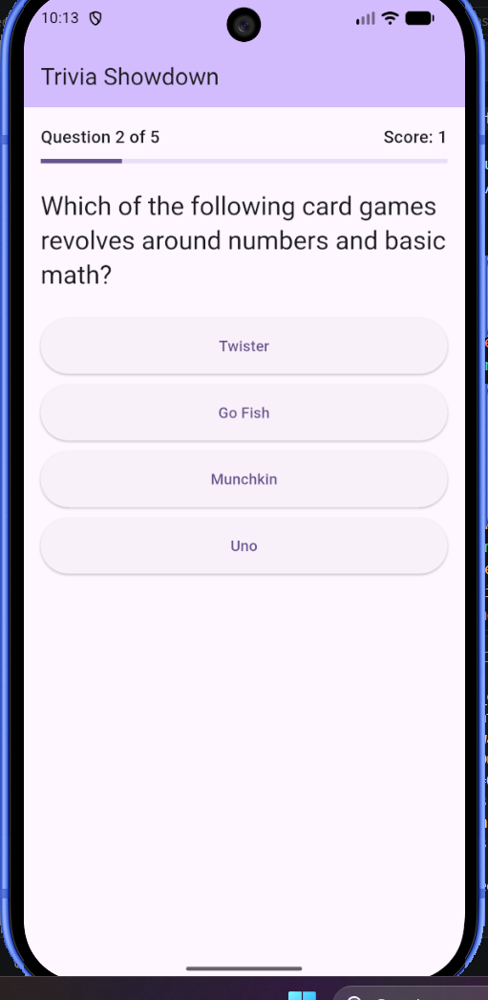
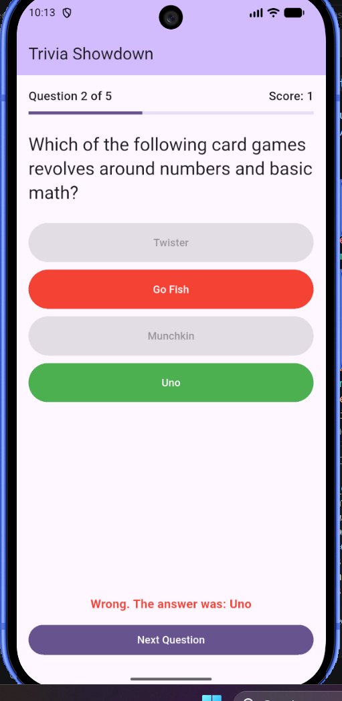
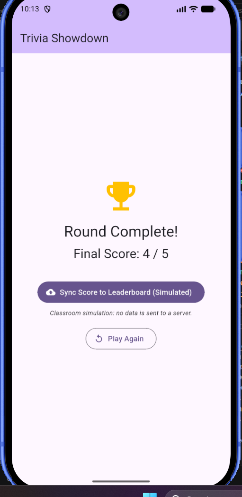
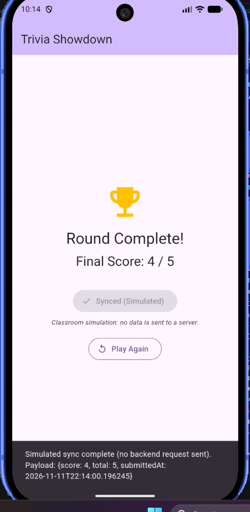

# In-Class 15 - Trivia Showdown

A simple Flutter trivia app. It pulls 5 questions from the Open Trivia Database, lets you answer them, and shows your score at the end.

## How to run

* `flutter pub get`
* `flutter run`
* `flutter test` to run the tests

## What the app does

* Gets 5 easy general knowledge questions from `https://opentdb.com/api.php?amount=5&category=9&difficulty=easy&type=multiple`
* Shows a loading spinner while the questions are loading
* Checks that the HTTP status is 200 and that the API `response_code` is 0 before using the data
* If something goes wrong (no internet, timeout, bad response), it shows an error message and a Retry button
* Fixes weird text like `&quot;`, `&#039;` and `&amp;` so the questions read normally
* Shuffles the answer choices
* Turns the right answer green and your wrong pick red
* You can only answer once per question, so tapping again doesn't give extra points
* Shows "Question X of 5", a progress bar, and your score as you go
* Shows your final score at the end, with a Play Again button that loads new questions
* Has a "Sync Score to Leaderboard" button. **This is only a simulation**: it waits 2 seconds and shows a message. No data is sent to any server.

## Files

* `lib/main.dart` - all the screens (loading, error, question, results)
* `lib/services/trivia_service.dart` - makes the API call and checks the response
* `lib/models/question.dart` - turns the JSON into a Question and cleans up the text
* `test/widget_test.dart` - tests for text cleanup, error handling, and a full round

## Screenshots

* Correct answer turns green

  

* A new question before answering (shuffled choices)

  

* Wrong answer: my pick is red and the right one is green

  

* Final score screen (4 / 5) with the sync and play again buttons

  

* After tapping sync: the button says "Synced (Simulated)" and the message says no backend request was sent

  

## About the score sync

* The sync button is a **simulation**, not a real cloud save
* It builds a payload with the score, the total, and the time, then just waits 2 seconds
* Nothing is sent to a server and nothing is saved anywhere
* A real version would send a POST request to a server and only say "synced" after the server says it worked

## Critical thinking answers

**1. If the internet drops after the questions are loaded, what should happen?**

* All 5 questions come in one request at the start, so once they're loaded the game doesn't need the internet anymore
* So the player should be able to finish the round and see their score like normal
* If they hit Play Again with no internet, the app shows the error screen with a message and a Retry button instead of a blank screen
* For a real score sync, if the internet was down I'd show that it failed and let them try again, and never say "synced" unless the server actually confirmed it

**2. What's one thing worth saving locally?**

* I'd save the player's best score
* That way they can see if they're getting better, even after closing the app
* But it would still not be a leaderboard, because it only lives on that one phone
* Other players can't see it, and it's gone if the app gets deleted
* A real leaderboard needs a shared server that everyone sends their scores to, so I'd label it "Your best score (this device)" so nobody gets confused

## How this connects

* This app only reads data with a GET request
* Saving a score for real would use a POST request with the score in JSON
* The app would then check the server's response to know if it worked or failed, the same way it checks the trivia response
